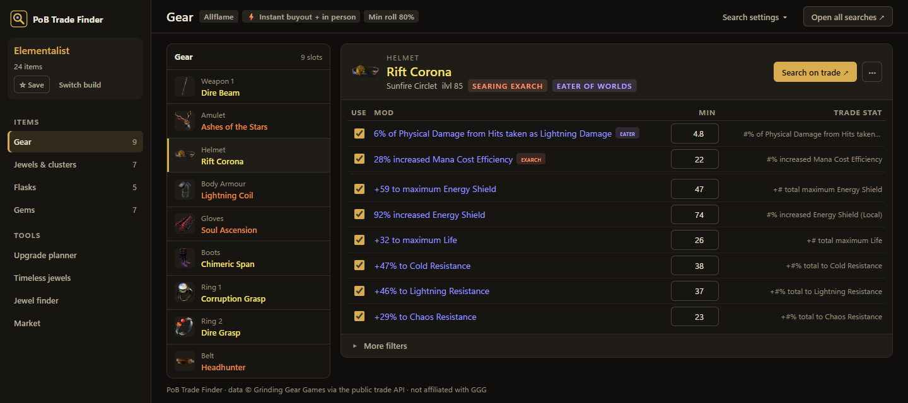

# PoB Trade Finder

**Paste a Path of Building code → get one-click, pre-filled official trade searches for
every piece of gear in the build.** Shop for exactly the items the build creator used —
no more hand-typing mods into pathofexile.com/trade.

📖 **[User Guide](docs/USER-GUIDE.md)** · 🔧 **[Developer Guide](docs/DEVELOPER.md)** · 📦 **[Releases](https://github.com/Jagomeiister/pob-trade-finder/releases)**

## Install (Windows)

Download the latest zip from [Releases](https://github.com/Jagomeiister/pob-trade-finder/releases),
extract anywhere, run **`PoB Trade Finder.exe`**. The app updates itself from future releases.

From source: `pip install pywebview`, then `python gui.py`.
(Opening `index.html` in a browser also works — search building only, no live prices.)

## What it does

- **Decodes PoB export codes and share links** (pobb.in / pastebin / poe.ninja) — every
  gear set in the build, every slot: gear, uniques, jewels, cluster jewels, flasks, gems —
  shown as a slot list beside one item at a time
- **Matches every mod to official trade stats** — implicits, crafted, fractured,
  enchants, influences, cluster notables — with per-mod checkboxes, min-roll % control,
  and inputs clamped to what each mod can actually roll
- **One-click searches** on pathofexile.com/trade with everything pre-filled, plus
  socket/link, item-level, base-percentile, and require-fractured filters
- **Live price checking in-app** — item art, mod tiers and roll percentiles, DPS and
  base percentile, open affix slots, chaos-equivalent prices, and a whole-build cost
  summary; click any mod to sort all listings by it
- **Instant buyout aware** — fee display and site hand-off for instant listings;
  one-click **in-game whisper** and `/hideout` for in-person trades
- **Live search** with sound alerts for new listings; sold listings grey out automatically
- **Upgrade planner** — build cost table, a budget solver that finds the cheapest combo
  meeting your res/life targets, a shopping basket, and compare-with-your-character
- **Jewel tools** — a timeless jewel seed finder for all six timeless jewels (from Path of
  Building's tables), and a rare/abyss jewel finder that ranks mods by what your tree scales
- **In-game price check (Ctrl+D) that knows your build**: *is this an upgrade?* against your PoB
  item and what you wear, instant prices (exchange feed, poe.ninja), a suggested list price,
  mod tiers, and sellers' online/AFK status
- **In-game overlays and hotkeys** like Awakened PoE Trade / PoE Lurker:
  - a PoB icon and trade cards over the game; each can be dragged anywhere and follows the
    game window;
  - **Shift+Space** opens the whole app over the game (resizable, Esc or a click in the game
    to go back);
  - **Alt+T** shows or hides the trade cards;
  - a tray icon keeps it running.
- **🤝 Trade helper** (selling):
  - a card for every trade whisper; Invite / Busy / Sold / Still interested, then Trade /
    Kick / Thanks once the buyer is in your hideout — **one chat command per press, never
    on its own**;
  - stash cell outline, your own card buttons, and sounds (built in or your own file) with a
    volume slider;
  - Sales history (chaos + divine, chart, CSV) and buyer notes (reputation, flag, hide,
    merge one player's characters). All local.
- **👁 Watcher's Eye & co.**:
  - Watcher's Eye with your build's auras pre-picked, current or legacy mods, and every pair
    or triple priced;
  - Forbidden Flame / Flesh pairs for your ascendancy;
  - Thread of Hope ring sizes.
- **🔤 Search text** for the stash / vendor search box (like poe.re): map mods to avoid or want,
  item quantity, presets, and one-press **Paste into game**
- **🃏 Div cards**: which areas drop the valuable cards and where each card drops
- **Learned filters**: pasted / Ctrl+D items remember the mods you always switch on or off
- **🌳 Skill tree** (a mini Path of Building): your build's tree with jewels and masteries, and
  the points still to take compared with your character, in the order you can take them
- **Craft vs buy**, and a **currency market**
  page from GGG's hourly exchange feed, with price alerts
- **Five themes** (Dark, Dim, Slate, Light, Parchment) with five accents, all checked for readable contrast;
  full keyboard use
- **Self-updating**, rate-limit safe (reads GGG's quota headers), league-start data
  refresh built in

## Updating data / releasing

| Task | Command |
|---|---|
| New league / new stats | ⚙ Settings → **Refresh trade data**, or `python tools/refresh_all.py` (every table + tests) |
| New mods (roll ranges) | `python tools/make_ranges.py --fetch` |
| New bases (item art) | `python tools/make_baseicons.py --fetch` |
| Run tests | `node test/test.js` (+ `test_craft.js`, `test_jewels.js`, `test_contrast.js`, and the `test/*.py` suites) |
| Release | bump `VERSION` in `gui.py` → `python tools/build_release.py` → `gh release create v{V} dist/PoBTradeFinder-v{V}.zip` |

PoE 1 only for now. MIT licensed.

### Not affiliated with GGG

**This product isn't affiliated with or endorsed by Grinding Gear Games in any way.** It's
a free fan project, and no community-made tool is GGG-approved. Path of Exile and its
item art belong to GGG. How the app behaves toward GGG's services:

- **Price checks** use the trade site's unofficial endpoints (as other trade tools do),
  identify the app in their User-Agent, and follow the rate limits the site reports.
  GGG doesn't officially support these endpoints for third-party tools.
- **Searches only run when you act:** one search per click or hotkey press. Batch buttons
  (Check all prices and similar) go one search at a time with a gap between them and
  can be stopped. Saved-build price tracking only *reminds* you; it never searches
  on a timer.
- **Whispers, trade helper buttons and hotkeys** do one thing per press (one chat line, one
  Ctrl+C, one search box paste). Nothing is sent on a timer or because of something in the
  log, Invite and Trade are separate buttons, and the app never reads or changes the game's
  memory.
- **The trade helper reads the game's chat log (Client.txt)** only after you switch it on.
  Sales, buyer notes and flags stay on your PC.
- **The Market** uses GGG's public, documented currency-exchange feed.
- **POESESSID** (optional) stays on your PC and is sent only to pathofexile.com.
- **Official login (coming):** the app has GGG's documented OAuth sign-in built in (public
  client, PKCE, local callback) for stash value, switched off until GGG issues it a
  client id. GGG isn't accepting new applications at the moment.

Timeless jewel and Watcher's Eye data from [Path of Building](https://github.com/PathOfBuildingCommunity/PathOfBuilding)
(MIT); mod range and map mod data via [RePoE](https://repoe-fork.github.io/); divination card
drop areas from the [Path of Exile Wiki](https://www.poewiki.net/) (CC BY-NC-SA 3.0).
