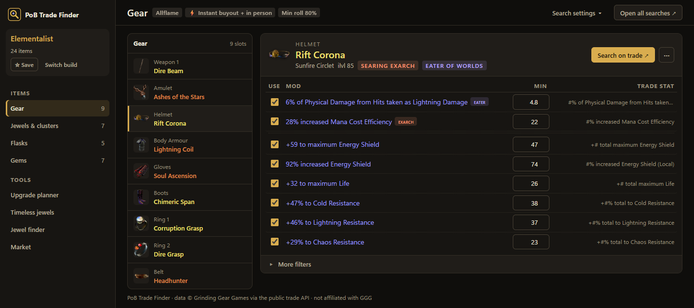

# PoB Trade Finder

**Paste a Path of Building code → get one-click, pre-filled official trade searches for
every piece of gear in the build.** Shop for exactly the items the build creator used —
no more hand-typing mods into pathofexile.com/trade.

📖 **[User Guide](docs/USER-GUIDE.md)** · 🔧 **[Developer Guide](docs/DEVELOPER.md)** · 📦 **[Releases](https://github.com/Jagomeiister/pob-trade-finder/releases)**

## Install (Windows)

Download the latest zip from [Releases](https://github.com/Jagomeiister/pob-trade-finder/releases),
extract anywhere, run **`PoB Trade Finder.exe`**. The app updates itself from future releases.

From source: `pip install pywebview`, then `python gui.py`.
(Opening `index.html` in a browser also works — search building only, no live prices.)

## What it does

- **Decodes PoB export codes and share links** (pobb.in / pastebin / poe.ninja) — every
  gear set in the build, every slot: gear, uniques, jewels, cluster jewels, flasks, gems —
  shown as a slot list beside one item at a time
- **Matches every mod to official trade stats** — implicits, crafted, fractured,
  enchants, influences, cluster notables — with per-mod checkboxes, min-roll % control,
  and inputs clamped to what each mod can actually roll
- **One-click searches** on pathofexile.com/trade with everything pre-filled, plus
  socket/link, item-level, base-percentile, and require-fractured filters
- **Live price checking in-app** — item art, mod tiers and roll percentiles, DPS and
  base percentile, open affix slots, chaos-equivalent prices, and a whole-build cost
  summary; click any mod to sort all listings by it
- **Instant buyout aware** — fee display and site hand-off for instant listings;
  one-click **in-game whisper** and `/hideout` for in-person trades
- **Live search** with sound alerts for new listings; sold listings grey out automatically
- **Upgrade planner** — build cost table, a budget solver that finds the cheapest combo
  meeting your res/life targets, a shopping basket, and compare-with-your-character
- **Jewel tools** — a timeless jewel seed finder for all six timeless jewels (from Path of
  Building's tables), and a rare/abyss jewel finder that ranks mods by what your tree scales
- **Craft vs buy**, an **in-game price-check hotkey** (Ctrl+D), and a **currency market**
  page from GGG's hourly exchange feed
- **Dark and light themes** with five accents, all checked for readable contrast;
  full keyboard use
- **Self-updating**, rate-limit safe (reads GGG's quota headers), league-start data
  refresh built in

## Updating data / releasing

| Task | Command |
|---|---|
| New league / new stats | ⚙ Settings → **Refresh trade data**, or `python tools/refresh_all.py` (every table + tests) |
| New mods (roll ranges) | `python tools/make_ranges.py --fetch` |
| New bases (item art) | `python tools/make_baseicons.py --fetch` |
| Run tests | `node test/test.js` (+ `test_craft.js`, `test_jewels.js`, `test_contrast.js`, and the `test/*.py` suites) |
| Release | bump `VERSION` in `gui.py` → `python tools/build_release.py` → `gh release create v{V} dist/PoBTradeFinder-v{V}.zip` |

PoE 1 only for now. Not affiliated with Grinding Gear Games. Mod range data via
[RePoE](https://repoe-fork.github.io/). MIT licensed.
